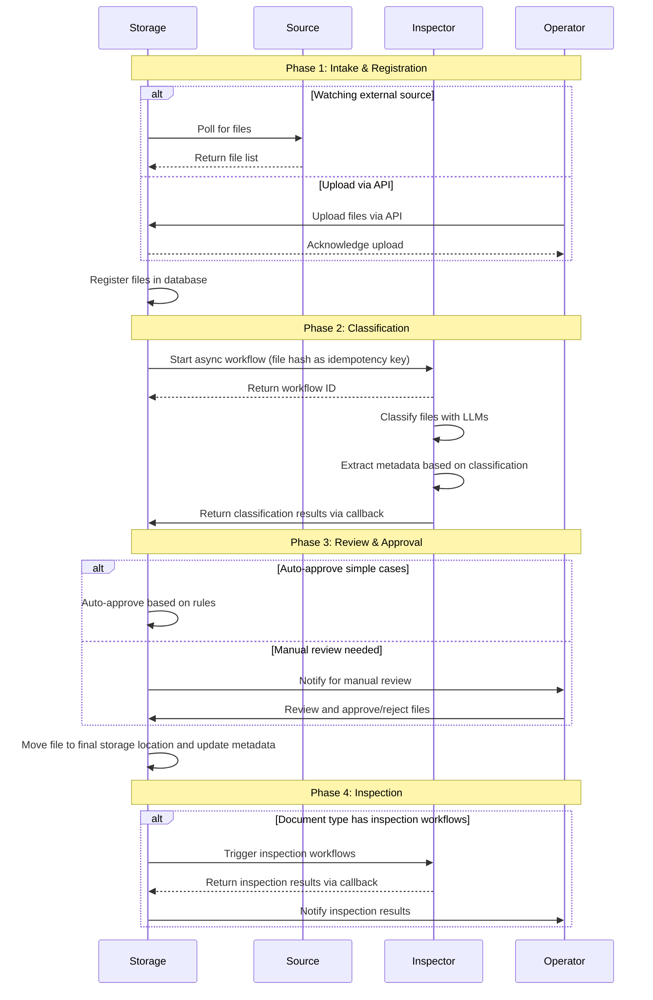

# **Fidudoc MVP: Use Cases & Storage API Specification**

**Version:** 1.0\
**Date:** October 2025

This specification describes MVP user flows and API design direction. API endpoints are preliminary and will be refined during development based on real data and user feedback from users.

Focus areas:

- User-facing workflows
- System workflow & sequencing
- API structure

## **1\. User-Facing Use Cases**

### **1.1. Administrator Use Cases**

#### _1.1.1. System Configuration_

**When** setting up the system\
**I want to** configure all system settings via JSON\
**So that** document intake, routing, and processing work correctly

**Flow:**

1. Get current settings via `GET /settings`
2. Edit JSON (intake sources, routing rules, auto-approval settings)
3. Update via `PUT /settings`
4. System validates and applies new settings

**Success:** System configured and ready to process documents

#### _1.1.2. User Management_

**When** team structure changes\
**I want to** manage user accounts and permissions\
**So that** only authorized people access sensitive documents

**Flow:**

1. Create user via `POST /users`
2. Assign roles and document access permissions
3. Update user via `PUT /users/{id}` if needed
4. Review access via `GET /audit-log`

**Success:** Users have appropriate access levels

### **1.2. Operator Use Cases**

#### _1.2.1. Daily Inbox Processing_

**When** new documents arrive\
**I want to** review and approve classifications\
**So that** documents are correctly filed

**Flow:**

1. Query inbox: `GET /documents?status=pending_approval&period=24h`
2. Review each document with extracted data
3. Bulk approve: `POST /documents/approve {"ids": [...]}`
4. Or reject for correction: `POST /documents/reject {"ids": [...]}`

**Success:** All inbox documents processed

#### _1.2.2. Exception Handling_

**When** workflow flags issues\
**I want to** review and resolve exceptions\
**So that** problematic documents are addressed

**Flow:**

1. Query exceptions: `GET /documents?validation_status=failed`
2. Review document and extracted data via `GET /documents/{id}/extracted-data`
3. Correct classification if needed
4. Approve or escalate

**Success:** Exception queue empty or documented

#### _1.2.3. Client Document Registry_

**When** working on client tasks\
**I want to** see all documents for a specific client\
**So that** I have complete context

**Flow:**

1. Query: `GET /documents?client_id=X&status=approved`
2. Filter by type or date if needed
3. Preview document: `GET /documents/{id}/preview`
4. Review extracted data: `GET /documents/{id}/extracted-data`

**Success:** Found all relevant documents for task

#### _1.2.4. Entity Resolution_

**When** system finds new entities\
**I want to** confirm or merge them\
**So that** entity database stays clean

**Flow:**

1. Query entities: `GET /entities`
2. Get merge suggestions: `GET /entities/suggestions?doc_id=X`
3. Confirm or merge entities
4. Track in audit log

**Success:** No duplicate entities, relationships clear

#### _1.2.5. Review VAT Validation Results_

**When** Inspector validates purchase invoices\
**I want to** see flagged VAT issues\
**So that** I can fix problems before VAT return

Flow:

1. Query alerts: `GET /documents?inspection_type=vat&status=flagged`
2. See issue type (invalid VAT number, wrong rate, missing mention)
3. Review source document and extracted data
4. Either: correct in accounting system, or mark as exception

**Success**: All VAT issues reviewed before filing deadline

#### _1.2.6. Monitor Lease VAT Options_

**When** Inspector detects lease contracts\
**I want to** be alerted about VAT option requirements\
**So that** I don't miss VAT deduction opportunities

Flow:

1. Query alerts:\
   `GET /documents?inspection_type=lease_vat&status=action_required`
2. See: "Unfurnished lease \- VAT option must be requested"
3. Track action taken (requested/not applicable)

**Success**: No missed VAT option deadlines

1.2.7. Track Contract Expiries

**When** Inspector extracts contract dates\
**I want to** see upcoming renewals\
**So that** I don't miss critical deadlines

Flow:

1. Dashboard shows contracts expiring in 30 days
2. Filter by type (lease/service/loan)
3. Mark as: renewed/terminated/in progress

**Success**: Zero surprise expirations

## **2\. System Workflow**

### **2.1. Document Processing Flow**

**Trigger:** New document uploaded to configured intake source

**Actors:**

- **Storage** (state manager, API orchestrator)
- **Inspector** (workflow processor via trigger.dev)
- **Cron Job** (intake poller)

**Detailed Flow:**

#### _Phase 1: Intake & Registration_

1. **Cron job** polls configured intake sources (e.g., Google Drive folder)
2. For each new file, **Cron** triggers workflow via trigger.dev SDK:\
   await tasks.trigger("process-document-workflow", {

   fileId, fileName, mimeType, createdTime

   })

3. **Inspector workflow** starts with `fileId` as idempotency key

#### _Phase 2: Download & Classification_

4. **Inspector** downloads file from source
5. **Inspector** uploads to Storage inbox (temporary location)
6. **Inspector** registers document in Storage registry (safe point \#1)
7. **Inspector** classifies document type using Claude AI
8. **Inspector** extracts metadata based on document type

#### _Phase 3: Permanent Storage (Safe Point \#2)_

9. **Inspector** moves file to permanent storage location
10. **Inspector** deletes from inbox
11. **Inspector** stores extracted data as JSON (if applicable)
12. **Inspector** updates registry with classification results

#### _Phase 4: Completion_

13. **Inspector** calls Storage webhook with results:\
    POST /webhooks/workflow-complete

    {

    docId, status, documentType, confidence,

    pdfStoragePath, jsonStoragePath, error

    }

14. **Storage** updates document status based on config:
    - If `autoApproval.enabled && confidence >= minConfidence` → status \= `approved`
    - Else → status \= `pending_approval`
15. If configured, **Storage** can trigger additional inspection workflows

#### _Error Handling_

- **Download failures** → workflow returns `download_failed` status, no retry
- **Classification failures** → default to `unknown` type, continue processing
- **Storage failures** → workflow throws error, trigger.dev retries from last safe point
- **Webhook delivery** → trigger.dev handles retries with exponential backoff
- **Lost webhooks** → Storage periodically polls workflow status via trigger.dev SDK

**Success:** Document classified, stored, and ready for approval/usage\
**Failure:** Document in exception queue with error details in registry

## **3\. Sequence Diagram**

## **4\. API Specification**

**Note**: Endpoint details will be refined during implementation. The structure below shows intended capabilities, not final contract.

### **4.1. Storage API**

**Base URL:** `https://storage.fidudoc.com/v1`

#### _Settings_

| Method | Endpoint   | Description                      |
| :----- | :--------- | :------------------------------- |
| GET    | `/settings` | Get current system settings      |
| PUT    | `/settings` | Update system settings           |

**Settings Structure (example):**

`{`\
`"intake": {`\
`"sources": [{`\
`"type": "gdrive",`\
`"folderId": "...",`\
`"polling": "5m"`\
`}]`\
`},`\
`"routing": {`\
`"rules": [{`\
`"documentType": "invoice",`\
`"destination": "clients/{client_id}/invoices/{year}"`\
`}]`\
`},`\
`"queryTemplates": [...],`\
`"autoApproval": {`\
`"enabled": true,`\
`"minConfidence": 0.9`\
`}`\
`}`

#### _Documents_

| Method | Endpoint                         | Description                   | Query Params                                                               |
| :----- | :------------------------------- | :---------------------------- | :------------------------------------------------------------------------- |
| GET    | `/documents`                     | List/filter documents         | `status`, `client_id`, `type`, `validation_status`, `period`, `from`, `to` |
| GET    | `/documents/{id}`                | Get document metadata         | \-                                                                         |
| GET    | `/documents/{id}/preview`        | Get document preview/download | \-                                                                         |
| GET    | `/documents/{id}/extracted-data` | Get extracted structured data | \-                                                                         |
| POST   | `/documents/approve`             | Approve documents             | Body: `{"ids": ["..."]}`                                                   |
| POST   | `/documents/reject`              | Reject documents              | Body: `{"ids": ["..."], "reason": "..."}`                                  |

**Example Queries:**

`GET /documents?status=pending_approval&period=24h`\
`GET /documents?client_id=X&type=invoice&status=approved`\
`GET /documents?validation_status=failed&validation_type=vat`

#### _Users & Audit_

| Method | Endpoint      | Description     |
| :----- | :------------ | :-------------- |
| GET    | `/users`      | List users      |
| POST   | `/users`      | Create user     |
| PUT    | `/users/{id}` | Update user     |
| GET    | `/audit-log`  | Get audit trail |

#### _Entities_

| Method | Endpoint                | Description           | Query Params        |
| :----- | :---------------------- | :-------------------- | :------------------ |
| GET    | `/entities`             | List entities         | `type`, `client_id` |
| GET    | `/entities/suggestions` | Get merge suggestions | `doc_id`            |

#### _Internal Webhooks_

| Method | Endpoint                      | Description                  | Called By |
| :----- | :---------------------------- | :--------------------------- | :-------- |
| POST   | `/webhooks/workflow-complete` | Workflow completion callback | Inspector |

**Webhook Payload:**

`{`\
`"docId": "abc123",`\
`"status": "processed" | "download_failed" | "extraction_failed",`\
`"documentType": "invoice",`\
`"confidence": 0.95,`\
`"pdfStoragePath": "...",`\
`"jsonStoragePath": "...",`\
`"error": "..." // if failed`\
`}`

### **4.2. Inspector (No REST API)**

Inspector is implemented as trigger.dev workflows. No REST API exposed.

**Triggering workflows:**

`import { tasks } from "@trigger.dev/sdk/v3";`

`const handle = await tasks.trigger(`\
`"process-document-workflow",`\
`{`\
`fileId: "...",`\
`fileName: "...",`\
`mimeType: "...",`\
`createdTime: "..."`\
`}`\
`);`

**Classification & extraction rules:** Defined in code, not configurable via API in MVP.

## **5\. Out of Scope for MVP**

- Advanced search/NLP queries
- Intelligence graph component
- Automated remediation workflows
- Configurable classification/extraction rules via API
- Document versioning (deferred until we see real documents)
- Saved custom queries (only templates)
